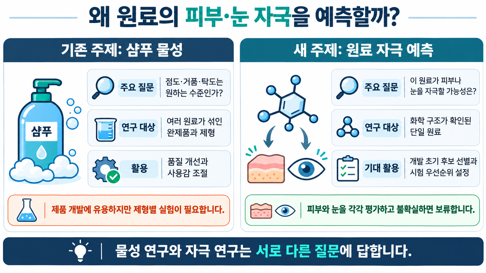

# 화장품 원료의 피부·눈 자극 예측 연구

화학 구조가 확인된 **단일 원료**에 대해 피부와 눈의 자극 관련 시험 결과를 각각 예측하고, 근거가 부족하거나 불확실할 때는 판단을 보류하는 연구입니다. 이 자료는 2026년 11월 3일까지의 작업 현황을 팀원에게 설명하기 위한 공유본입니다.

> **현재는 자료 확보와 검증 준비 단계입니다.** 시험법별 모델 성능과 완제품 안전성은 아직 확인되지 않았습니다. 확정된 외부검증 코호트는 없습니다.

## 처음 보는 팀원을 위한 그림

1. [연구 주제와 샴푸 물성 비교](images/04_topic_comparison_detailed.png)
2. [피부·눈 병렬 연구 절차](images/05_research_process_detailed.png)
3. [현재 진행 상황과 남은 과제](images/06_status_and_next_steps_detailed.png)



샴푸 물성 연구는 점도·거품·탁도처럼 제형의 품질을 다룹니다. 이 연구는 개발 초기에 원료의 자극 가능성을 검토하고 시험 우선순위를 정하는 데 도움을 주는 것을 목표로 합니다. **서로 다른 질문을 다루며, 어느 연구가 보편적으로 더 좋다는 뜻은 아닙니다.**

## 현재까지의 결과

| 항목 | 현재 상태 |
|---|---|
| 눈 개발자료 후보 | EURL ECVAM 공개 검증자료에서 76개 CAS, 828개 관측 행을 정리. 반복 실행이 포함되며 독립 시험 수가 아님 |
| 피부 개발자료 후보 | 과거 EpiDerm 15분/42시간 4물질과 Vitrolife 18시간·42시간 각 13물질을 별도로 정리 |
| 원래 피부 목표 | EpiDerm 60분/42시간 자료와 시험계보는 추가 확보 필요. 위 피부 자료를 같은 시험으로 합치지 않음 |
| 후보 근거 점검 | 피부 24행·눈 43행. A/B/C 등급 미배정, 최종평가 등록 0건 |
| 위험 게이트 | 피부 부식·눈 Category 1 근거가 위험 또는 미확인이면 보류. 양쪽이 모두 사전 기준을 충족할 때만 공동 검토 후보 |
| 독립 평가 | 독립 라벨 관리자 부재. 새 물질·시험 독립성 확인, 평가계획과 예측 고정이 선행되어야 함 |

기존 학습에 사용된 193개 물질은 미지 화학물질 외부검증 대상으로 사용할 수 없습니다. 105개 물질도 검색 단서일 뿐 최종 평가 코호트가 아닙니다.

## 파일 안내

| 경로 | 용도 |
|---|---|
| [docs/research_overview.md](docs/research_overview.md) | 연구 배경, 용어, 절차와 한계 |
| [docs/data_guide.md](docs/data_guide.md) | 자료별 단위, 이용 범위와 주의점 |
| [docs/sharing_and_next_steps.md](docs/sharing_and_next_steps.md) | 공유 전 확인, 눈가림과 후속 과제 |
| [data/research_workbook.xlsx](data/research_workbook.xlsx) | 후보·출처·개발 관측값을 모은 통합문서. 개인 PC의 절대경로는 제거 |
| [data/candidates/](data/candidates/) | 후보별 근거, 공동 판정과 결과 노출 기록 |
| [data/development/](data/development/) | 시험법별 공개 개발자료 후보. **이미 관측된 결과가 포함됨** |
| [data/sources/](data/sources/) | 공개 출처 목록과 실제로 발송하지 않은 요청 이력 |
| [code/](code/) | 정식 위험 게이트 v2.1과 형 검증 테스트 |
| [images/](images/) | 팀 설명용 이미지 3장 |

## 코드 확인

Python 3에서 외부 패키지 없이 게이트 테스트를 실행할 수 있습니다.

```bash
python -m unittest discover -s code -p "test_*.py" -v
```

이 코드는 위험 근거와 입력 형식에 따른 **보수적 판정 규칙**만 제공합니다. 예측 모델이 아니며, 시험자료 추출·학습·성능평가 전체가 이 폴더에서 재현되는 것은 아닙니다.

## 공유 시 유의사항

개발자료와 공개 출처에는 결과가 포함되거나 연결되어 있습니다. 독립 라벨 관리자를 위한 눈가림 저장소로 사용하면 안 됩니다. 외부 원문 PDF는 이 폴더에 재배포하지 않으며, 공개 저장소에 결과 데이터와 그림을 올리기 전에는 각 원자료의 재사용 조건을 확인하세요. 사용자 이름과 접근키 등 비공개 정보도 포함하지 마세요.
